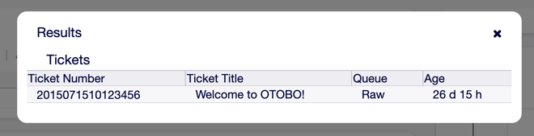

Elasticsearch
=============

If Elasticsearch is activated in your system,
the *Elasticsearch* field is shown in the header of every agent screen.
Use it to quickly find tickets, customers, customer users and config items by a full-text search.

   Elasticsearch Field

To search for something:

1. Click on the *Elasticsearch* field or press the access key ``u``.
2. Enter at least two characters.
   The *Results* dialog opens and is updated while you type.
3. Click on a result to open it.

   Results Dialog

The *Results* dialog groups the results into *Tickets*, *Customers*, *Customer Users* and *ConfigItems*.
A group is only shown if it contains results.

To see all matching tickets, press the *Enter* key in the *Elasticsearch* field.
The ticket search results screen opens.
If the search finds only one ticket, the ticket opens directly.

How the Search Works
--------------------

OTOBO adds an asterisk ``*`` before and after your search term:
``print`` becomes ``*print*``.
The search term is therefore also found inside longer words, for example in *printer* and *blueprint*.

If you enter several words, OTOBO finds results that contain at least one of the words:
``printer error`` becomes ``*printer error*`` and finds tickets with *printer* or *error*.

To find results that contain all words, enter ``AND`` between the words:
``printer AND error`` becomes ``*printer AND error*`` and finds only tickets with both *printer* and *error*.

.. note::

   Phrase search is not possible.
   Quotation marks around several words do not find this exact phrase.

.. note::

   The search has been improved considerably in OTOBO 11.1.

.. note::

   An administrator has to activate Elasticsearch before the *Elasticsearch* field is shown.
   Without it, use the :doc:`Ticket Search <../tickets/search>` or the :doc:`FAQ Search <../faq/search>`.
